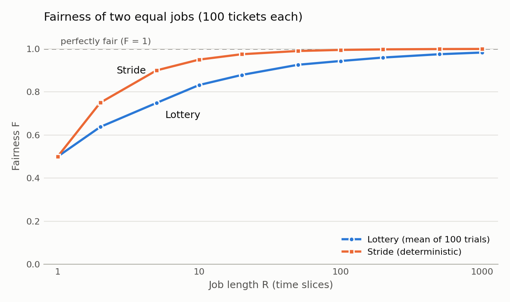

# Chapter 9 (Scheduling: Proportional Share) — Homework (Simulation)

Zhiyuan Pan

All runs use `lottery.py` in `ostep-homework/cpu-sched-lottery/`. Questions 2–5
need statistics over many random seeds, so I wrote
[`code/chapter9/lottery_exp.py`](code/chapter9/lottery_exp.py). It runs the
official simulator with `-c` once per seed and only collects the results; it
also contains a small stride scheduler for Q5. Everything can be reproduced
with [`code/chapter9/run.sh`](code/chapter9/run.sh).

How the simulator picks a winner: `winner = random % total_tickets`, then it
walks the job list, adding up tickets, until the running sum is greater than
`winner`. So job 0 owns tickets `0 … t0−1`, job 1 owns `t0 … t0+t1−1`, and so
on. Each lottery runs the winner for one quantum (`-q`, default 1). A finished
job's tickets are removed from the total.

---

## Q1

> Compute the solutions for simulations with 3 jobs and random seeds of 1, 2,
> and 3.

**Seed 1** (`./lottery.py -s 1 -j 3`): Job 0 (length 1, 84 tickets), Job 1
(length 7, 25 tickets), Job 2 (length 4, 44 tickets). 153 tickets in total, so
Job 0 owns 0–83, Job 1 owns 84–108, Job 2 owns 109–152.

| random | % total | winner | notes |
|---|---|---|---|
| 651593 | 651593 % 153 = 119 | Job 2 | 119 is in 109–152 |
| 788724 | 788724 % 153 = 9 | Job 0 | Job 0 **done at time 2**; total becomes 69 (Job 1: 0–24, Job 2: 25–68) |
| 93859 | 93859 % 69 = 19 | Job 1 | |
| 28347 | 28347 % 69 = 57 | Job 2 | |
| 835765 | 835765 % 69 = 37 | Job 2 | |
| 432767 | 432767 % 69 = 68 | Job 2 | Job 2 **done at time 6**; total becomes 25 |
| 762280, 2106, 445387, 721540, 228762, 945271 | (only Job 1 left) | Job 1 × 6 | Job 1 **done at time 12** |

**Seed 2** (`-s 2 -j 3`): Job 0 (length 9, 94 tickets), Job 1 (length 8,
73 tickets), Job 2 (length 6, 30 tickets). Job 0 has the most tickets and
wins 9 of the first 14 lotteries. Completion times: **Job 0 at 14, Job 1 at
22, Job 2 at 23.**

**Seed 3** (`-s 3 -j 3`): Job 0 (length 2, 54 tickets), Job 1 (length 3,
60 tickets), Job 2 (length 6, 6 tickets). Job 2 has only 6 of 120 tickets and
never wins while the others are running. Completion times: **Job 1 at 4,
Job 0 at 5, Job 2 at 11.**

In all three cases my hand-computed winners matched `-c`.

## Q2

> Now run with two specific jobs: each of length 10, but one (job 0) with 1
> ticket and the other (job 1) with 100 (e.g., `-l 10:1,10:100`). What happens
> when the number of tickets is so imbalanced? Will job 0 ever run before job 1
> completes? How often? In general, what does such a ticket imbalance do to the
> behavior of lottery scheduling?

With the default seed, Job 1 wins all of the first 10 lotteries and finishes at
time 10. Job 0 only runs after that (time 10–20). Job 0 owns just ticket 0 out of
101, so each lottery has a 1/101 ≈ 1% chance of picking it.

**Will job 0 ever run before job 1 completes? Yes, but rarely.** Over 1000
seeds:

| times job 0 ran before job 1 finished | runs (out of 1000) | theory |
|---|---|---|
| 0 | 898 (89.8%) | (100/101)^10 = 90.5% |
| 1 | 94 (9.4%) | 9.0% |
| 2 | 8 (0.8%) | 0.5% |

So job 0 sneaks in before job 1 finishes in about **10%** of runs (theory:
1 − (100/101)^10 ≈ 9.5%), and almost always only once. Job 1's completion time
is 10, or occasionally 11.

**In general**, a large ticket imbalance makes lottery scheduling behave almost
like a **strict priority scheduler**: the job with most of the tickets runs
almost all the time, and the job with few tickets gets about its proportional
share (here ~1%) and is nearly starved until the big job finishes. Unlike
strict priority, though, the small job is never completely starved: it always
has a non-zero chance of running.

## Q3

> When running with two jobs of length 100 and equal ticket allocations of 100
> (`-l 100:100,100:100`), how unfair is the scheduler? Run with some different
> random seeds to determine the (probabilistic) answer; let unfairness be
> determined by how much earlier one job finishes than the other.

I used the chapter's fairness metric **F = (time the first job finishes) /
(time the second job finishes)**. F = 1 is perfectly fair; the second job always
finishes at time 200, so F = 0.5 would mean one job finished at 100. Over 1000
seeds:

| statistic | value |
|---|---|
| mean F | **0.944** |
| median F | 0.950 |
| worst (min) F | 0.810 |
| best (max) F | 0.995 (finish times 199 and 200) |
| middle 90% of runs | 0.870 – 0.995 |
| gap between the two finish times | mean **11.1**, median 10, max 38 time units |

Distribution: F ≥ 0.95 in 53.8% of runs, 0.90–0.95 in 33.1%, 0.80–0.90 in
13.1%, and never below 0.8. Seeds 0–9 gave 0.960, 0.980, 0.950, 0.980, 0.995,
0.905, 0.965, 0.925, 0.955, 0.960.

So with 100-slice jobs the scheduler is **fairly fair on average**: one job
usually finishes about 10 time units (5%) before the other. But it is never
guaranteed. In an unlucky run one job finished 38 units earlier (F = 0.81).

## Q4

> How does your answer to the previous question change as the quantum size
> (`-q`) gets larger?

`-l 100:100,100:100 -q Q`, 200 seeds for each quantum:

| quantum | lotteries per job | mean F | worst F |
|---|---|---|---|
| 1 | 100 | 0.944 | 0.830 |
| 2 | 50 | 0.923 | 0.770 |
| 5 | 20 | 0.877 | 0.625 |
| 10 | 10 | 0.829 | 0.550 |
| 20 | 5 | 0.756 | 0.500 |
| 25 | 4 | 0.724 | 0.500 |
| 50 | 2 | 0.629 | 0.500 |
| 100 | 1 | **0.500** | 0.500 |

**The larger the quantum, the more unfair the scheduler.** Each job needs
100/Q lotteries, so a bigger quantum means fewer lotteries, and lottery
scheduling only approaches the right proportions over many lotteries (law of
large numbers). With Q = 100, a single lottery decides everything: the winner
runs to completion at time 100 and the other finishes at 200, so F is always
exactly 0.5. Increasing the quantum has the same effect as making the jobs
shorter in Figure 9.2.

## Q5

> Can you make a version of the graph that is found in the chapter? What else
> would be worth exploring? How would the graph look with a stride scheduler?

**Reproducing Figure 9.2.** Two jobs, 100 tickets each, both of length R, with
R from 1 to 1000. For each R, I averaged F over 100 seeds (the book used 30;
30 seeds gives almost the same curve). The orange line is a stride scheduler
on the same workload.

| R | 1 | 2 | 5 | 10 | 20 | 50 | 100 | 200 | 500 | 1000 |
|---|---|---|---|---|---|---|---|---|---|---|
| lottery F | 0.500 | 0.637 | 0.749 | 0.832 | 0.879 | 0.926 | 0.944 | 0.960 | 0.975 | 0.983 |
| stride F | 0.500 | 0.750 | 0.900 | 0.950 | 0.975 | 0.990 | 0.995 | 0.998 | 0.999 | 1.000 |

The lottery curve matches the book's figure: low fairness for short jobs
(F ≈ 0.5 at R = 1, ≈ 0.8 at R = 10), approaching 1 only when the jobs run for
hundreds of time slices.

**With a stride scheduler**, the curve is much higher and is deterministic: no
averaging is needed. With equal tickets the two jobs simply alternate, so one
finishes at 2R − 1 and the other at 2R:

$$
F_{\text{stride}} = \frac{2R - 1}{2R}
$$

That is already 0.95 at R = 10, where lottery only reaches about 0.83. The only
unfair case is R = 1, where one job must go first (F = 0.5 for both
schedulers). Stride gets the proportions exactly right at every point in time,
not just on average. The trade-off, as the chapter notes, is global state: each
job needs a pass value, and it is unclear what pass value to give a newly
arriving job. Lottery needs no per-job state at all.

**Other things worth exploring:**

- **Unequal tickets.** With `-l 1000:200,1000:100` (a 2:1 ratio), while both
  jobs were running, job 0 won 1000 lotteries and job 1 won 472, a ratio of
  2.12:1, close to the ideal 2:1. Stride gives exactly 2:1: job 0 finishes at
  1500 and job 1 at 2000.
- **More than two jobs**, and how F (or each job's share) behaves as the number
  of jobs grows.
- **Jobs of different lengths**, or jobs arriving at different times. This is
  where stride's "what pass value for a new job" problem shows up.
- **The quantum and job length together**: Q4 shows that what matters is the
  number of lotteries (R/Q), not R alone.
- **Ticket mechanisms** from the chapter (ticket currency, transfer and
  inflation) and their effect on fairness.
