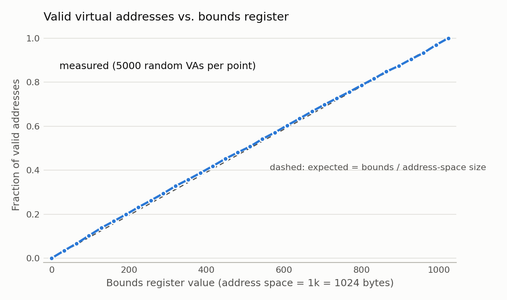

# Chapter 15 (Mechanism: Address Translation) — Homework (Simulation)

Zhiyuan Pan

All runs use `relocation.py` in `ostep-homework/vm-mechanism/`. Every command
below can be rerun with [`code/chapter15/run.sh`](code/chapter15/run.sh). For
the questions that need a search or many seeds, I used a small helper,
[`code/chapter15/reloc_exp.py`](code/chapter15/reloc_exp.py). It runs the
official simulator with `-c` and only collects the results.

The simulator models **base-and-bounds** (dynamic relocation):

- A virtual address (VA) is **valid if VA < bounds** (the `Limit` register).
  Otherwise the hardware raises a **segmentation violation**.
- A valid VA translates to **PA = base + VA**.
- The base must leave room for the whole address space:
  **base + bounds ≤ physical memory size**.

Defaults: address space 1k (`-a`), physical memory 16k (`-p`), 5 addresses
(`-n`); the base and bounds are random unless set with `-b` / `-l`.

---

## Q1

> Run with seeds 1, 2, and 3, and compute whether each virtual address
> generated by the process is in or out of bounds. If in bounds, compute the
> translation.

**Seed 1** (`./relocation.py -s 1`): base = 13884 (0x363c), bounds = 290.

| VA | VA < 290? | result |
|---|---|---|
| 782 (0x30e) | no | **violation** |
| 261 (0x105) | yes | 13884 + 261 = **14145** (0x3741) |
| 507 (0x1fb) | no | **violation** |
| 460 (0x1cc) | no | **violation** |
| 667 (0x29b) | no | **violation** |

**Seed 2** (`-s 2`): base = 15529 (0x3ca9), bounds = 500.

| VA | VA < 500? | result |
|---|---|---|
| 57 (0x39) | yes | 15529 + 57 = **15586** (0x3ce2) |
| 86 (0x56) | yes | 15529 + 86 = **15615** (0x3cff) |
| 855 (0x357) | no | **violation** |
| 753 (0x2f1) | no | **violation** |
| 685 (0x2ad) | no | **violation** |

**Seed 3** (`-s 3`): base = 8916 (0x22d4), bounds = 316.

| VA | VA < 316? | result |
|---|---|---|
| 378 (0x17a) | no | **violation** |
| 618 (0x26a) | no | **violation** |
| 640 (0x280) | no | **violation** |
| 67 (0x43) | yes | 8916 + 67 = **8983** (0x2317) |
| 13 (0xd) | yes | 8916 + 13 = **8929** (0x22e1) |

All 15 translations matched `-c`. With the default settings the bounds is
between 1/4 and 1/2 of the 1k address space, while virtual addresses are drawn
from the whole 1k space, so most addresses are out of bounds.

## Q2

> Run with these flags: `-s 0 -n 10`. What value do you have to set `-l` (the
> bounds register) to in order to ensure that all the generated virtual
> addresses are within bounds?

Without `-l`, the run gives bounds = 472 and 6 of the 10 addresses are
violations. The largest virtual address generated is **929** (0x3a1), and an
address is valid only if VA < bounds, so the bounds must be at least
**930**:

```
-l 929: 9/10 valid      (VA 929 is still a violation)
-l 930: 10/10 valid
```

**Answer: `-l 930`** (or anything larger). Setting the bounds to the full
address-space size, `-l 1024`, guarantees that *any* address the simulator can
generate for a 1k address space is valid.

One subtlety: when `-l` is given, the simulator no longer draws a random
bounds value, so the random sequence shifts and the 10 addresses are not
exactly the same as without `-l` (a new VA, 776, appears first). The largest
generated address is still 929 in both cases, so the answer does not change.

## Q3

> Run with these flags: `-s 1 -n 10 -l 100`. What is the maximum value that
> base can be set to, such that the address space still fits into physical
> memory in its entirety?

The address space occupies physical addresses base … base + bounds − 1, which
must all lie inside physical memory (16k = 16384 bytes):

$$
\text{base} + \text{bounds} \le \text{physical memory size}
\quad\Longrightarrow\quad
\text{base}_{\max} = 16384 - 100 = 16284
$$

Checked with the simulator (my helper binary-searches `-b` against the
simulator's own fit check):

```
-b 16284 -> runs normally (highest valid PA = 16284 + 99 = 16383, the last byte of memory)
-b 16285 -> Error: address space does not fit into physical memory with those base/bounds values.
            Base + Limit: 16385   Psize: 16384
```

**Answer: base = 16284.**

## Q4

> Run some of the same problems above, but with larger address spaces (`-a`)
> and physical memories (`-p`).

| command | base | bounds | valid / 10 |
|---|---|---|---|
| `-s 1 -n 10 -a 16k -p 64k` | 55537 | 4646 | 3 |
| `-s 2 -n 10 -a 32m -p 1g` | 1017722014 | 16408404 | 4 |
| `-s 0 -n 10 -a 64k -p 32m -l 40k` | 28334095 | 40960 | 7 |

For example, in the first run VA 4179 is below the bounds 4646 and translates
to 55537 + 4179 = **59716**, while VA 12513 is a violation. The numbers get
bigger but the rule is exactly the same: compare with the bounds, then add the
base.

The answers to Q2 and Q3 also generalize:

| question | command | result | formula |
|---|---|---|---|
| Q2 (smallest bounds) | `-s 0 -n 10 -a 16k -p 64k` | largest VA 14878 → `-l 14879` | max VA + 1 |
| Q3 (largest base) | `-s 1 -n 10 -a 16k -p 64k -l 4k` | `-b 61440` | 65536 − 4096 |
| Q3 (largest base) | `-s 1 -n 10 -a 32m -p 1g -l 10m` | `-b 1063256064` | 1073741824 − 10485760 |

In general, the smallest safe bounds is (largest VA used) + 1, or the full
address-space size to be safe for every address; and the largest base is
**physical memory size − bounds**. The simulator also requires the physical
memory to be larger than the address space (e.g. `-a 16k` with the default
`-p 16k` is rejected).

## Q5

> What fraction of randomly-generated virtual addresses are valid, as a
> function of the value of the bounds register? Make a graph from running with
> different random seeds, with limit values ranging from 0 up to the maximum
> size of the address space.

Experiment: 1k address space (`-p 4096`), bounds from 0 to 1024 in steps of
32. For each bounds value I ran 50 seeds × 100 addresses (`-n 100`), i.e. 5000
random virtual addresses per point, and counted how many the simulator marked
VALID.



| bounds | 0 | 128 | 256 | 384 | 512 | 640 | 768 | 896 | 1024 |
|---|---|---|---|---|---|---|---|---|---|
| bounds / 1024 | 0.000 | 0.125 | 0.250 | 0.375 | 0.500 | 0.625 | 0.750 | 0.875 | 1.000 |
| measured valid fraction | 0.000 | 0.137 | 0.262 | 0.387 | 0.507 | 0.635 | 0.755 | 0.874 | 1.000 |

The fraction of valid addresses grows **linearly** with the bounds register:

$$
\text{fraction valid} \approx \frac{\text{bounds}}{\text{address-space size}}
$$

This is expected: the simulator picks each virtual address uniformly from
0 … asize − 1, and an address is valid exactly when it is below the bounds.
The endpoints are exact: with bounds = 0 every address is a violation, and
with bounds = asize every address is valid. The measured points stay within
about 0.01 of the line; the small differences are random sampling noise. A
second run with a 16k address space (`-a 16k -p 64k`, 20 seeds) gave the same
line: 0.260, 0.511 and 0.754 at bounds = 1/4, 1/2 and 3/4 of the space.
