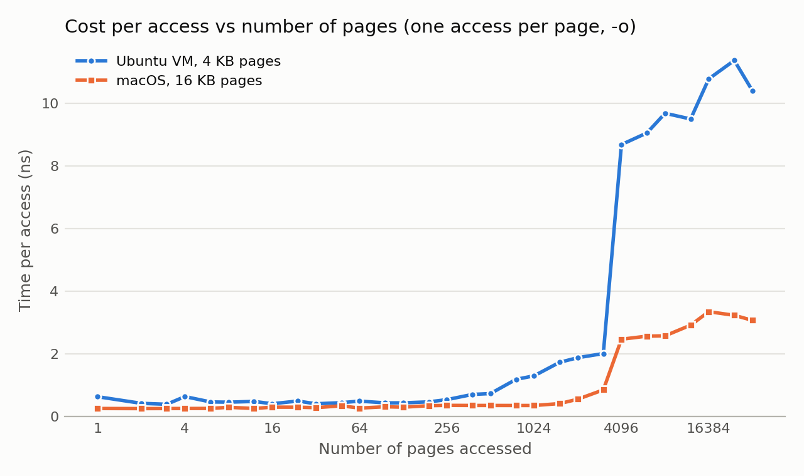
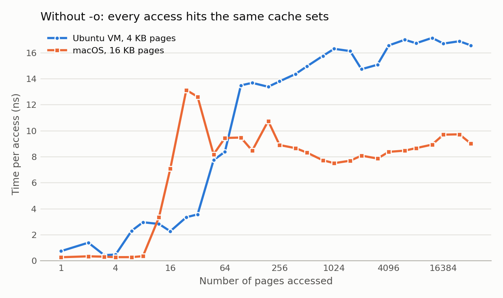

# Chapter 19 (Paging: Faster Translations (TLBs)) — Homework (Measurement)

Zhiyuan Pan

Code is in [`code/chapter19/`](code/chapter19/):

- [`tlb.c`](code/chapter19/tlb.c): the TLB measurement program.
- [`timer.c`](code/chapter19/timer.c): timer precision (Q1).
- [`tlb_exp.py`](code/chapter19/tlb_exp.py): runs `tlb` for the sweep, the
  trials, pinning and initialization experiments, and draws the graphs.
- [`run.sh`](code/chapter19/run.sh): reruns everything.
- `Makefile`: also builds an `-O0` version and a deliberately wrong "naive"
  version for Q5.

I measured on two systems on the same Apple M4 laptop:

| system | page size | pinning |
|---|---|---|
| **Ubuntu 24.04 VM** (VirtualBox, 4 vCPUs, aarch64, gcc 13.3 `-O2`) | 4 KB | `sched_setaffinity` to CPU 0 |
| **macOS 15**, native (clang `-O2`) | 16 KB | not possible (see Q6) |

---

## Q1

> For timing, you'll need to use a timer (e.g., `gettimeofday()`). How precise
> is such a timer? How long does an operation have to take in order for you
> to time it precisely? (this will help determine how many times, in a loop,
> you'll have to repeat a page access in order to time it successfully)

`timer.c` calls each timer back to back a million times and records the
smallest non-zero difference:

| | `gettimeofday()` | `clock_gettime(CLOCK_MONOTONIC)` |
|---|---|---|
| Ubuntu VM | **1 µs** (it only returns microseconds) | **41 ns** (one tick of the 24 MHz ARM counter; `clock_getres` claims 1 ns) |
| macOS | 1 µs | 1 µs |

`gettimeofday()` can never be better than 1 µs because its result is in
microseconds. On Linux, `clock_gettime()` is about 25× finer, so I used it.

A single memory access takes well under 1 ns when it hits in the TLB and
cache, which is far below either resolution. To time something with about 1%
error, the measured interval must be at least ~100× the timer resolution:
**≥ 4 µs with `clock_gettime` (Linux), ≥ 100 µs with `gettimeofday`**. In
practice interrupts and scheduling add noise, so a few milliseconds is safer.
At 0.3–10 ns per access that means **10⁵–10⁷ accesses per measurement**.
`tlb_exp.py` therefore sets `trials = 2²⁴ / pages`, i.e. about **16.8 million
accesses** (5–150 ms) per measurement, whatever the number of pages.

## Q2

> Write the program, called `tlb.c`, that can roughly measure the cost of
> accessing each page. Inputs to the program should be: the number of pages
> to touch and the number of trials.

Usage: `./tlb [-c cpu] [-n] [-o] numpages trials`. It prints
`numpages trials ns_per_access checksum`. The core is the loop from the
chapter: touch one integer on each page, and repeat over all pages `trials`
times.

```c
long pagesize = sysconf(_SC_PAGESIZE);
long jump = pagesize / sizeof(int);   // ints per page: a[i * jump] is on page i
...
double start = now_ns();              // clock_gettime(CLOCK_MONOTONIC)
for (long t = 0; t < trials; t++)
    for (long i = 0; i < numpages; i++)
        a[idx[i]] += 1;               // idx[i] = i * jump (+ a cache-line offset with -o)
double end = now_ns();
printf("%ld %ld %.3f %ld\n", numpages, trials, (end - start) / (numpages * trials), sum);
```

- The page size comes from `sysconf`, so it works with 4 KB (Linux) and
  16 KB (macOS) pages.
- `-c cpu` pins the process (Q6), `-n` skips initialization (Q7), and `sum`
  is the checksum (Q5).

**A problem I found: `-o`.** With the plain `a[i * jump]`, every access is at
offset 0 of a page. Page-aligned addresses all map to the **same few L1 cache
sets** (the M4's L1 data cache is 128 KB, 8-way, so addresses 16 KB apart
share a set). After a handful of pages the program measures L1 **cache
conflict misses**, not the TLB. With `-o`, page *i* uses cache line
*i mod (lines per page)* instead, so each page still gets exactly one access,
but the accesses spread over all cache sets. The difference is shown in Q4.
Every result below uses `-o` unless I say otherwise.

## Q3

> Now write a script in your favorite scripting language (bash?) to run this
> program, while varying the number of pages accessed from 1 up to a few
> thousand, perhaps incrementing by a factor of two per iteration. Run the
> script on different machines and gather some data. How many trials are
> needed to get reliable measurements?

`tlb_exp.py sweep` runs `tlb` for 1, 2, 3, 4, 6, 8, 12, 16, … 32768 pages
(powers of two plus the point halfway between, so the jumps are located more
precisely), with ~16.8M accesses per run, and takes the median of 3 runs.

| pages | 1 | 16 | 64 | 256 | 512 | 1024 | 2048 | 3072 | **4096** | 8192 | 32768 |
|---|---|---|---|---|---|---|---|---|---|---|---|
| Ubuntu VM (ns) | 0.64 | 0.41 | 0.50 | 0.54 | 0.74 | 1.30 | 1.88 | 2.01 | **8.69** | 9.69 | 10.41 |
| macOS (ns) | 0.26 | 0.30 | 0.27 | 0.36 | 0.36 | 0.36 | 0.56 | 0.85 | **2.47** | 2.58 | 3.08 |

The full data are in `code/chapter19/data/{vm,mac}_{o,plain}.csv`.

**How many trials?** `tlb_exp.py trials` runs 16 pages with a growing number
of trials, 10 times each (Ubuntu VM):

| trials | accesses | mean ns/access | stdev | min – max |
|---|---|---|---|---|
| 1 | 16 | 3.63 | 37% | 2.56 – 5.19 |
| 10 | 160 | 1.15 | 32% | 0.78 – 1.83 |
| 100 | 1,600 | 0.42 | 9% | 0.36 – 0.47 |
| 1,000 | 16,000 | 0.49 | 75% | 0.31 – 1.24 |
| 10,000 | 160,000 | 0.35 | 22% | 0.29 – 0.55 |
| 100,000 | 1.6M | 0.36 | 7% | 0.32 – 0.41 |
| 1,000,000 | 16M | 0.37 | **4%** | 0.35 – 0.40 |

With few trials, the result is dominated by timer resolution and the cost of
the first (cold) pass, and is far too high. Even at 1,000–10,000 trials, a
single interrupt can spoil a run (the 75% row). The answer stops changing and
the spread drops to a few percent only at **about 10⁵–10⁶ trials, i.e.
millions of accesses (≳ 1 ms) per measurement**. That is why the sweep uses
~16.8M accesses and takes the median of several runs. For the large page
counts the same budget gives fewer trials (e.g. 512 trials at 32768 pages),
which is still millions of accesses.

## Q4

> Next, graph the results, making a graph that looks similar to the one
> above. Use a good tool like `ploticus` or even `zplot`. Visualization
> usually makes the data much easier to digest; why do you think that is?

I drew the graphs with matplotlib (`tlb_exp.py plot`).



How I read the graph:

- **Up to ~256 pages: about 0.3–0.6 ns per access.** Every translation hits
  in the first-level TLB. This is less than one cycle per access because
  the accesses are independent and the out-of-order CPU overlaps them; the
  program measures throughput, not the latency of a single access.
- **Ubuntu VM, 256 → 3072 pages: a gradual rise to ~2 ns.** The pages no
  longer fit in the first-level TLB, but the translations still hit in the
  larger second-level TLB. On macOS this step is much smaller (0.36 ns up to
  1024 pages). Past 2048 pages the touched cache lines (2048 × 64 B =
  128 KB) also stop fitting in the L1 data cache, which adds to the rise on
  both systems.
- **3072 → 4096 pages: a big jump, on both systems.** This is the
  second-level TLB running out: it holds about 3000 entries, and beyond that
  almost every access needs a page-table walk. It is a TLB effect, not a
  cache effect: at 4096 pages the program touches only 4096 cache lines
  (256 KB), which fit easily in the 16 MB L2 cache. Also, the jump is at the
  same **number of pages** on both systems although the pages differ in size
  by 4×. The TLB reach is therefore about 3072 × 4 KB = 12 MB in the VM and
  3072 × 16 KB = 48 MB on macOS.
- **A TLB miss costs ~3–4× more inside the VM** (8.7–11 ns vs 2.5–3.3 ns per
  access). In a VM a miss needs a **two-dimensional page walk**: each step of
  the guest page table is itself a guest-physical address that must be
  translated through the host's (stage-2) table, which means up to ~24 memory
  references instead of 4. This is a real cost of virtualization that the
  TLB normally hides.

The graph without `-o` shows why the cache-line offset matters:



Without `-o` the cost jumps at **16 pages on macOS** and at **48 pages in the
VM**, far below any TLB size. Those are L1 cache conflict misses. On macOS
every page-aligned address maps to the same cache set, so 8 ways are full
after 8 pages; in the VM, 4 KB pages spread over 4 sets × 8 ways = 32 lines.
After that every access goes to the L2 cache (~8–17 ns). Someone reading
only this graph would conclude the TLB has 8–32 entries, which is wrong.

**Why visualization helps:** a table of 29 numbers per system has to be read
one by one, and it is easy to miss where the behavior changes. On a graph the
shape is visible at once: the flat region, the knee at 3072–4096 pages, the
difference between the two systems, and the suspicious early jump without
`-o`. The eye is very good at spotting changes in slope and comparing two
lines; the brain is slow at comparing columns of digits. A log-scale x-axis
also makes powers-of-two sizes evenly spaced, which matches how TLBs and
caches are sized.

## Q5

> One thing to watch out for is compiler optimization. Compilers do all sorts
> of clever things, including removing loops which increment values that no
> other part of the program subsequently uses. How can you ensure the
> compiler does not remove the main loop above from your TLB size estimator?

The loop must have an effect that the compiler cannot prove is useless:

1. The loop **writes** to the array (`a[i] += 1`), not just reads it.
2. After timing, the program **reads the array back and prints the sum** (the
   checksum column). The value of every increment now affects the output, so
   the compiler has to perform all of them. The checksum also checks the
   work: it must equal `numpages × trials` (16,777,216 in the runs below).

Other ways: declare the array `volatile` (this changes the code that is
generated, though), or put an empty `asm volatile("" ::: "memory")` barrier
in the loop. Always check the result for plausibility, or look at the
assembly (`gcc -O2 -S`).

To show the danger, the Makefile builds two extra versions:

- `tlb-O0`: the same code without optimization.
- `tlb-naive`: built with `-DNAIVE`. Its timed loop only **reads** the array
  into `unused += a[idx[i]]` and never uses the result.

| version (Ubuntu VM, `-o`) | 16 pages | 1024 pages | 8192 pages |
|---|---|---|---|
| `tlb` (`-O2`, writes + checksum) | 0.38 ns | 0.96 ns | 6.66 ns |
| `tlb-O0` | 1.93 ns | 2.95 ns | 13.12 ns |
| `tlb-naive` (`-O2`, result unused) | **0.000 ns** | **0.000 ns** | **0.000 ns** |

The naive version reports **0 ns per access**: gcc and clang both see that
`unused` is never used and **delete the whole loop**, so nothing is measured
at all. The `-O0` version is the opposite problem: it keeps the loop
counters in memory, which adds several instructions to every access. It is
2–5× slower in the TLB-hit region, so the TLB effect is a smaller fraction of
the total. The right setup is `-O2` with a loop whose result is used.

## Q6

> Another thing to watch out for is the fact that most systems today ship
> with multiple CPUs, and each CPU, of course, has its own TLB hierarchy. To
> really get good measurements, you have to run your code on just one CPU,
> instead of letting the scheduler bounce it from one CPU to the next. How can
> you do that? (hint: look up "pinning a thread" on Google for some clues)
> What will happen if you don't do this, and the code moves from one CPU to
> the other?

**How:** on Linux, set the CPU affinity, which is what `tlb -c 0` does:

```c
cpu_set_t set;
CPU_ZERO(&set);
CPU_SET(cpu, &set);
sched_setaffinity(0, sizeof(set), &set);   // 0 = this process
```

You can also do it from the shell with `taskset -c 0 ./tlb ...`, or for one
thread with `pthread_setaffinity_np()`. macOS has **no** way to pin a thread
to a core (only affinity "hints"), so the macOS numbers are unpinned.

**What happens if you don't:** when the process moves to another CPU, its TLB
entries stay behind on the old CPU. On the new CPU every page misses again
until the TLB refills, which adds misses that have nothing to do with the
number of pages. If the CPUs differ (the M4 has performance and efficiency
cores with different TLBs, caches and clock speeds), part of a run is
measured on one kind of core and part on another, so the curve mixes two
different machines. My very first macOS run at 1 page gave 0.47 ns; later
runs gave 0.26 ns, most likely an efficiency core versus a performance core.

My measurements (`tlb_exp.py pin`, Ubuntu VM, 20 runs each):

| | pinned to CPU 0 | not pinned |
|---|---|---|
| 1024 pages | 1.14 ns ± 20% (0.97 – 1.85) | 0.92 ns ± 8.5% (0.81 – 1.06) |
| 8192 pages | 7.13 ns ± **2.7%** (6.71 – 7.47) | 7.22 ns ± **12.2%** (5.77 – 8.85) |

For the TLB-miss region (8192 pages), pinning made the runs much more
consistent (2.7% vs 12.2% spread). At 1024 pages it did not help. The reason
is that this is a VM: a guest "CPU 0" is just a thread of the VirtualBox
process, and macOS on the host still moves that thread between physical P and
E cores. Pinning inside the guest therefore cannot fully pin the code to one
physical core. On bare-metal Linux, pinning removes this source of noise
completely. Also, since each measurement makes millions of accesses, a single
migration costs relatively little: one refill of a few thousand TLB entries.
The bigger danger is a run that is split across different core types.

## Q7

> Another issue that might arise relates to initialization. If you don't
> initialize the array `a` above before accessing it, the first time you
> access it will be very expensive, due to initial access costs such as
> demand zeroing. Will this affect your code and its timing? What can you do
> to counterbalance these potential costs?

**Yes.** `malloc` of a large array only reserves virtual memory. The first
access to each page causes a **page fault**; the OS then allocates a physical
frame, **fills it with zeros**, and creates the page-table entry. `tlb -n`
skips the initialization loop, so these faults land inside the timed loop
(`tlb_exp.py init`, Ubuntu VM, median of 5 runs):

| trials | 1024 pages, initialized | 1024 pages, not initialized | 8192 pages, initialized | 8192 pages, not initialized |
|---|---|---|---|---|
| 1 | 7.7 ns | **1361 ns** | 6.2 ns | **1311 ns** |
| 10 | 1.2 ns | 137 ns | 8.3 ns | 138 ns |
| 100 | 1.4 ns | 14.0 ns | 8.1 ns | 20.2 ns |
| 1000 | 1.3 ns | 2.7 ns | 7.6 ns | 9.1 ns |

With one trial, every access is a first touch, so the result is the cost of a
page fault plus zeroing a 4 KB page: **about 1.3 µs per page**, 200–1000×
more than a TLB miss. With more trials the cost is spread over more accesses
(it shrinks as 1/trials), but even at 1000 trials it still inflates the
result by 20–100%. Without initialization, the graph would show page-fault
cost, not TLB behavior.

**How to counterbalance it:**

- **Touch every page before starting the timer.** `tlb.c` does this by
  default: it writes 0 to each page it will access. This is the simplest and
  most reliable fix.
- Alternatively, do one untimed warm-up pass of the loop, which also warms
  the TLB and caches; or ask the OS to pre-fault the memory
  (`mmap(..., MAP_POPULATE)` or `mlock()` on Linux).
- Use enough trials that any remaining one-time costs are small (Q3).
- Do not free and reallocate the array between trials, and keep the array
  smaller than physical memory so the pages are never swapped out.
