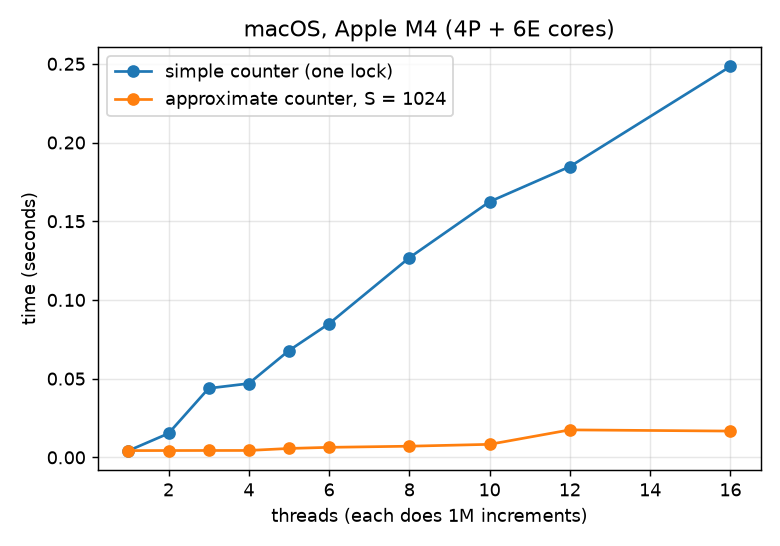
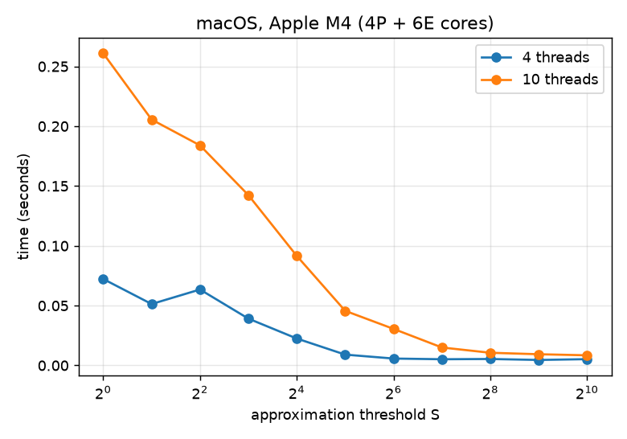
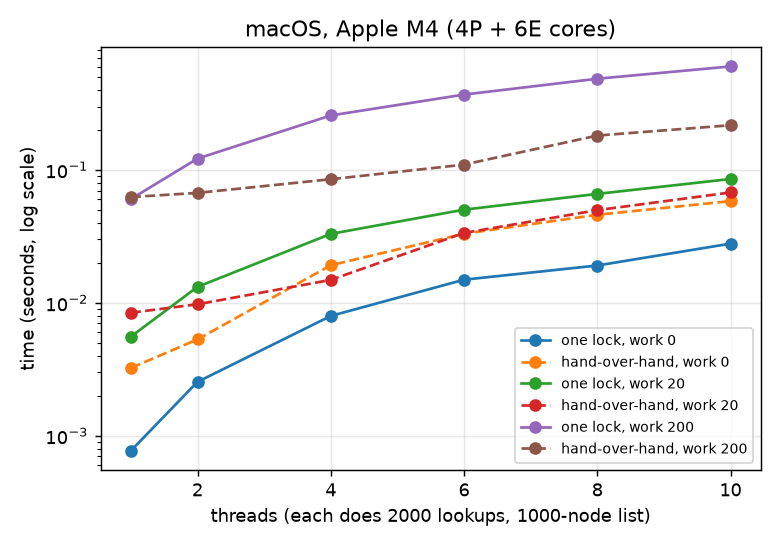
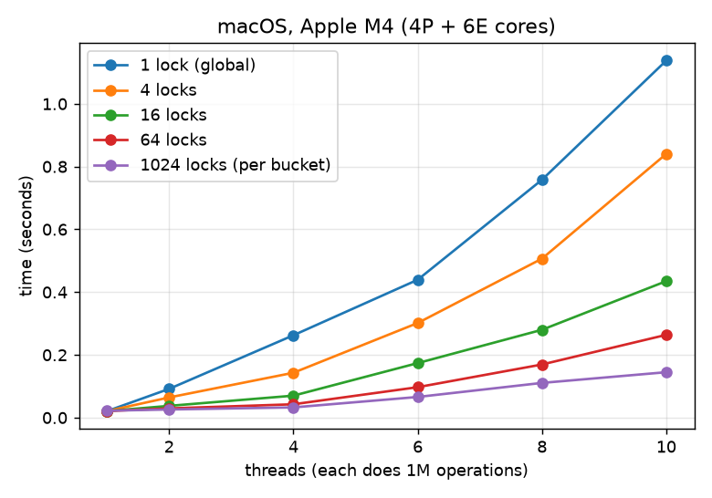

# Chapter 29 (Lock-based Concurrent Data Structures) — Homework (Code)

Zhiyuan Pan

All code is in [`code/chapter29/`](code/chapter29/):

| file | what it is |
|---|---|
| `common.h` | timer, a start gate so that thread creation is not timed, `busy_work()` |
| `timer.c` | Q1: resolution and cost of each timer |
| `counter.c` | Q2/Q3: the simple counter (Figure 29.2) and the approximate counter (Figure 29.4) |
| `list.c` | Q4: linked list with one lock (Figure 29.8) or hand-over-hand locking |
| `hash.c` | Q5/Q6: hash table with 1 lock, lock striping, or one lock per bucket |
| `ch29_exp.py` | runs every configuration 5 times (lists 3 times), writes `data/mac_*.csv`, draws the graphs |
| `run.sh` | builds everything and reruns all measurements |

**Machine.** A Mac with an **Apple M4**: 10 cores, **4 performance (P) and 6
efficiency (E) cores** (`sysctl hw.perflevel0.physicalcpu = 4`,
`hw.perflevel1.physicalcpu = 6`), compiled with `gcc -O2` (Apple clang). macOS
cannot pin threads to cores, so the scheduler places them. In practice the
first 4 busy threads run on P-cores and the rest on E-cores. I could not
repeat the runs in the Ubuntu VM: its saved state no longer matches its
configuration (`VERR_SSM_LOAD_CONFIG_MISMATCH`), and I did not want to discard
the saved state. The code also builds on Linux.

**Correctness.** Every program checks its own result and prints `ok` or
`WRONG` as the last field, and `ch29_exp.py` stops at the first `WRONG`. The
checks are: the counter's final value equals threads × increments; every
lookup in the list finds its key and the list has the right length; the hash
table's values add up to the number of updates. All runs reported here are
`ok`. Each point is the **median** of the repeated runs.

---

## Q1

> We'll start by redoing the measurements within this chapter. Use the call
> `gettimeofday()` to measure time within your program. How accurate is this
> timer? What is the smallest interval it can measure? Gain confidence in its
> workings, as we will need it in all subsequent questions. You can also look
> into other timers, such as the cycle counter available on x86 via the
> `rdtsc` instruction.

`timer.c` calls each timer 2 million times back to back. It records the
smallest non-zero difference (the resolution) and the average time per call
(the cost):

| timer | smallest step | cost per call |
|---|---|---|
| `gettimeofday()` | **1 µs** | 11.5 ns |
| `clock_gettime(CLOCK_MONOTONIC)` | 1 µs (`clock_getres` also says 1000 ns) | 17.9 ns |
| `mach_absolute_time()` | **41 ns** (one tick = 125/3 ns) | 7.8 ns |

- **`gettimeofday()` can measure intervals of 1 µs and no shorter**, because
  it returns microseconds. Each call is cheap (about 12 ns), so calling it
  does not disturb a measurement.
- On macOS, `clock_gettime()` also only has 1 µs resolution, although its
  struct has a nanosecond field.
- **`rdtsc` only exists on x86.** The ARM equivalent is the generic timer
  counter `cntvct_el0`. On the M4 it ticks at **24 MHz (41.67 ns)**, and
  `mach_absolute_time()` is the macOS interface to it. Reading `cntvct_el0`
  directly from user code does not work on macOS: the values were garbage and
  even went backwards. So `timer.c` reads it directly only on Linux. In the
  Ubuntu VM in chapter 19, Linux's `clock_gettime()` had a 41 ns step: the same
  24 MHz counter. Unlike x86's TSC, this counter does not count CPU cycles. It
  runs at a fixed frequency, so no conversion from cycles to time is needed.

**Gaining confidence in it.** My first version stored the absolute time in
nanoseconds in a `double` and reported a smallest step of **768 ns** for
`gettimeofday()`. That is impossible for a microsecond timer. The reason: the
current time is about 1.7 × 10¹⁸ ns, and a `double` has only 53 bits of
mantissa. At that size it can only represent multiples of 256 ns, so the
differences were rounded. Fixed by using 64-bit integer nanoseconds. The lesson
is to subtract a start time (or use integers) before converting.

**What this means for the measurements.** The benchmarks time themselves with
`clock_gettime()` (1 µs here). The shortest run reported below is 0.77 ms, or
770 ticks, so rounding is at most 0.13%. The run-to-run spread I saw (often
5–30%, more for runs under 10 ms) is therefore scheduling noise, not timer
error. That is why each point is the median of several runs.

## Q2

> Now, build a simple concurrent counter and measure how long it takes to
> increment the counter many times as the number of threads increases. How
> many CPUs are available on the system you are using? Does this number
> impact your measurements at all?

`counter.c` without `-s` is the chapter's counter: one `int` and one
`pthread_mutex_t`, locked around every increment. As in the chapter, each
thread increments it **one million times**, and I measure the total time from
the moment all threads are released until the last one finishes:



| threads | 1 | 2 | 3 | 4 | 5 | 6 | 8 | 10 | 12 | 16 |
|---|---|---|---|---|---|---|---|---|---|---|
| simple counter (ms) | **4.2** | 15.2 | 43.9 | 46.9 | 67.8 | 84.9 | 126.8 | 162.4 | 184.7 | 248.3 |
| ns per increment | 4.2 | 7.6 | 14.6 | 11.7 | 13.6 | 14.2 | 15.9 | 16.2 | 15.4 | 15.5 |

**The simple counter does not scale at all.** One thread does 1M increments in
4.2 ms. Two threads take 15 ms for 2M, so the total time grows 3.6× for 2× the
work. From then on it grows about linearly with the number of threads: every
increment is serialized by the one lock. On top of that, each increment costs
about **4× more** under contention (16 ns instead of 4 ns), because the lock and
the counter's cache line must move from core to core on every increment, and a
contended macOS mutex can put waiting threads to sleep in the kernel. The trend is
the same as in the chapter's Figure 29.5 (0.03 s for one thread, over 5 s for
two on a 2.7 GHz i5). That figure shows a much larger slowdown on older
hardware.

**Number of CPUs: 10 (4 P + 6 E).** For the simple counter it hardly matters,
since only one thread can do useful work at a time. More cores only means more
threads fighting for the lock. There is no visible change when the threads
exceed 10 cores (12, 16 threads). The cost per increment stays at about 15 ns,
because the time is dominated by handing the lock around, not by computing.

The number of CPUs **does** matter for the counter that can scale. The
approximate counter (next question) is flat up to 4 threads (the P-cores) and
then slows down (see Q3).

## Q3

> Next, build a version of the approximate counter. Once again, measure its
> performance as the number of threads varies, as well as the threshold. Do
> the numbers match what you see in the chapter?

`counter.c -s S` implements Figure 29.4. There is one local counter with its
own lock per CPU (`sysconf(_SC_NPROCESSORS_ONLN)` = 10 here), and thread *i*
uses local counter *i* mod 10. Every *S* local increments are added to the
global counter under the global lock. Each local counter is padded to its own
128-byte cache line (the M4's line size) so that threads do not slow each
other down through false sharing. The exact total is checked at the end as
global + all locals.

**Varying the number of threads (S = 1024, the chapter's setting)**, the
orange line in the graph above:

| threads | 1 | 2 | 3 | 4 | 5 | 6 | 8 | 10 | 12 | 16 |
|---|---|---|---|---|---|---|---|---|---|---|
| approximate (ms) | 4.3 | 4.3 | 4.4 | **4.4** | 5.7 | 6.4 | 7.1 | **8.3** | 17.5 | 16.7 |
| simple (ms), for comparison | 4.2 | 15.2 | 43.9 | 46.9 | 67.8 | 84.9 | 126.8 | 162.4 | 184.7 | 248.3 |

- **Up to 4 threads it scales perfectly:** 4M increments on 4 cores take the
  same 4.4 ms as 1M on one core, exactly what the chapter says ("hardly higher
  than the time taken to update it one million times on one processor").
- **5 to 10 threads:** the time rises to 8.3 ms. The extra threads run on
  **E-cores**, which are slower. I checked by forcing a 1-thread run onto
  E-cores with `taskpolicy -b ./counter -s 1024 1 1000000`. It takes
  **14–16 ms instead of 4–5 ms**, so the E-cores are about 3× slower for this
  loop. Since every thread does the same 1M increments, the total time is set
  by the slowest threads. The locks are not the problem here.
- **12 and 16 threads:** the time doubles to about 17 ms. There are more
  threads than cores, so threads take turns, and two threads now share a
  local counter (thread *i* uses local *i* mod 10), so they contend on the same
  local lock.

**Varying the threshold** (4 threads, as in the chapter's Figure 29.6, and
10 threads to use every core):



| S | 1 | 2 | 4 | 8 | 16 | 32 | 64 | 128 | 256 | 512 | 1024 |
|---|---|---|---|---|---|---|---|---|---|---|---|
| 4 threads (ms) | 72.3 | 51.3 | 63.5 | 39.1 | 22.5 | 9.0 | 5.7 | 5.2 | 5.4 | 4.6 | 5.2 |
| 10 threads (ms) | 260.9 | 205.6 | 184.0 | 142.4 | 91.6 | 45.6 | 30.5 | 15.0 | 10.6 | 9.3 | 8.5 |

- **S = 1 is worse than the simple counter** (72 ms vs 47 ms with 4 threads):
  every increment takes the local lock **and** the global lock, so all the
  contention of the simple counter remains and one extra lock is added.
- From about S = 8 the time roughly halves with every doubling of S, because
  the global lock is taken S times less often.
- It levels off at about **S = 64 for 4 threads** and **S = 256 for 10
  threads**. From there on the global lock is taken so rarely that it no longer
  matters. More threads need a larger S to get there, because more threads
  compete for the global lock.
- Runs of a few milliseconds are noisy (the spread for 4 threads at S ≥ 32 was
  100–570% of the median, from occasional runs where a thread was scheduled
  late). The medians are stable.

**Do the numbers match the chapter? The shape does, the scale does not.** As in
Figure 29.6, small S is slow and large S is about as fast as a single thread,
with a steep drop in between. And as in Figure 29.5, the approximate counter is
flat while the simple counter climbs. The absolute times are much smaller
(milliseconds instead of seconds) and the simple counter's slowdown is milder,
because the M4's locks and cache transfers are much faster than the chapter's
older Intel machine. The trade-off is the same as the chapter describes: with
large S the global value can lag the true count by up to CPUs × S (10 × 1024
here). That is the price of the speed.

## Q4

> Build a version of a linked list that uses hand-over-hand locking [MS04],
> as cited in the chapter. You should read the paper first to understand how
> it works, and then implement it. Measure its performance. When does a
> hand-over-hand list work better than a standard list as shown in the
> chapter?

**Hand-over-hand locking** (lock coupling, from Moir and Shavit, "Concurrent
Data Structures", 2004): every node has its own lock. A traversal **holds the
current node's lock while it acquires the next node's lock, and only then
releases the current one**. A thread therefore never holds more than two locks.
Because a thread always holds a lock on the node it is looking at, nobody can
unlink or change that node under it. Threads cannot overtake each other, but
several of them can walk the list at the same time at different positions,
like a pipeline. In `list.c`:

```c
static int hoh_lookup(int key) {
    node_t *prev = &list.head;          // sentinel; its lock guards head.next
    Pthread_mutex_lock(&prev->lock);
    node_t *cur = prev->next;
    while (cur != NULL) {
        Pthread_mutex_lock(&cur->lock);     // take the next node ...
        Pthread_mutex_unlock(&prev->lock);  // ... then let go of the previous one
        busy_work(work);                    // the "comparison" (see below)
        if (cur->key == key) { found = 1; break; }
        prev = cur;
        cur = cur->next;
    }
    Pthread_mutex_unlock(cur != NULL ? &cur->lock : &prev->lock);
    ...
}
```

Insert puts the new node at the head, so it only needs the sentinel's lock:
every traversal starts by locking the sentinel, so none can see a half-linked
node. The standard list (Figure 29.8) takes one lock around a whole lookup or
insert.

**Benchmark.** A 1000-node list; each thread does 2000 lookups of random
existing keys (about 500 nodes visited per lookup). A flag `-w` adds
`busy_work(w)` per node visited, an empty loop standing in for an expensive
key comparison (e.g. comparing strings or calling a comparison function).
w = 20 is about 5 ns per node and w = 200 about 60 ns per node.



| per-node work | list | 1 thread | 2 | 4 | 6 | 8 | 10 threads |
|---|---|---|---|---|---|---|---|
| none (w = 0) | one lock | **0.8** ms | 2.5 | 8.0 | 14.9 | 19.1 | **27.9** |
| | hand-over-hand | 3.2 | 5.3 | 19.2 | 33.1 | 46.0 | 58.3 |
| ~5 ns (w = 20) | one lock | **5.6** | 13.2 | 33.0 | 50.2 | 66.1 | 85.5 |
| | hand-over-hand | 8.4 | **9.8** | **14.9** | **33.6** | **49.8** | **67.7** |
| ~60 ns (w = 200) | one lock | 60.4 | 121.7 | 257.1 | 369.1 | 485.7 | 601.0 |
| | hand-over-hand | 62.5 | **67.2** | **85.1** | **109.7** | **181.4** | **217.0** |

**Without extra work, hand-over-hand always loses**, as the chapter predicts.
With one thread it is 4× slower (3.2 vs 0.8 ms): a lock and an unlock per node
cost about 2.4 ns, while just following a pointer and comparing an `int`
costs 0.8 ns. With more threads it is still about 2× slower. The single-lock
list serializes the lookups, but each one is very short. In the hand-over-hand
list every node's lock is a cache line that the threads keep taking from each
other as they move through the list one behind another.

**Hand-over-hand wins once the work per node is large compared with a
lock/unlock, and there is more than one thread:**

- With **w = 20** (about 5 ns of work per node, a few times the lock cost) it
  wins from **2 threads** on (9.8 vs 13.2 ms; 14.9 vs 33.0 ms at 4 threads).
  With one thread it still loses, because there is no concurrency to gain.
- With **w = 200** (60 ns per node) the locking overhead is negligible. One
  thread takes the same time with both lists (62 vs 60 ms). The one-lock
  list's time then grows linearly with the threads (10 threads: 601 ms, all
  work serialized), while hand-over-hand takes **217 ms for 10× the work: 2.8×
  faster**. It does not scale perfectly either (3.5× the time for 10× the
  work): threads queue behind each other node by node, and from 5 threads on
  they also run on the slower E-cores.

So a hand-over-hand list is better when (1) **several threads** use the list at
the same time, (2) **each step of the traversal is expensive** compared with a
lock/unlock (here: more than a few ns per node), and (3) the list is **long**,
so that traversals take long enough to overlap. For a list of `int`s with a
cheap comparison, the single lock is faster.

**A measurement lesson along the way.** My first `busy_work()` was a loop over
a `volatile` counter. With it, hand-over-hand looked **3× slower even with one
thread at w = 200** (198 vs 60 ms), which made no sense, since the extra cost
of locking does not depend on w. The volatile counter is loaded and stored
through memory on every iteration, and the speed of that dependency chain
changed with the surrounding code. With the counter in a register and an empty
`asm volatile("")` to keep the loop, both lists take 60 ms with one thread, as
they should. (The same kind of trap as compiler optimizations in chapter 19:
make sure you measure what you think you measure.)

## Q5

> Pick your favorite data structure, such as a B-tree or other slightly more
> interesting structure. Implement it, and start with a simple locking
> strategy such as a single lock. Measure its performance as the number of
> concurrent threads increases.

I chose a **hash table**: an array of buckets, each a linked list of
`(key, value)` nodes. `hash.c` has a configurable number of locks: bucket *b* is
protected by lock *b* mod *locks*. With `-l 1` it is the **simple strategy:
one lock for the whole table**.

**Benchmark.** 1024 buckets, 4096 keys (four per bucket). Each thread does
**1M operations** on random keys: 20% increment the key's value, 80% read it.
The table does not grow, so the chains stay the same length whatever the number
of threads, and the only thing that changes is the concurrency. Correctness
check: the values must add up to the number of increments, and every key must
be found.



| threads | 1 | 2 | 4 | 6 | 8 | 10 |
|---|---|---|---|---|---|---|
| **1 lock** (ms) | 20.9 | 91.7 | 262.5 | 439.4 | 758.0 | **1137.7** |
| ns per operation | 21 | 46 | 66 | 73 | 95 | 114 |

**With a single lock it gets worse with every thread.** 10 threads take
**54×** longer than one thread for 10× the work. As with the simple counter,
every operation is serialized, and in addition each one gets about 5× more
expensive (21 → 114 ns), because the lock (and the bucket data) has to move
between cores, and waiting threads go to sleep and must be woken up. Adding
threads only adds contention; a single thread is the fastest way to do this
work.

## Q6

> Finally, think of a more interesting locking strategy for this favorite data
> structure of yours. Implement it, and measure its performance. How does it
> compare to the straightforward locking approach?

**Strategy: finer-grained locks.** Operations on different buckets never touch
the same data, so they do not need to exclude each other. The extreme is
**one lock per bucket** (as in the chapter's Figure 29.10). In between is
**lock striping**: a fixed pool of *L* locks, bucket *b* using lock *b* mod *L*.
This uses less memory than one lock per bucket and still spreads the
contention. Each lock gets its own cache line, so that two locks never share
one. I measured *L* = 1, 4, 16, 64 and 1024 (= one per bucket) with the same
workload:

| locks \ threads | 1 | 2 | 4 | 6 | 8 | 10 |
|---|---|---|---|---|---|---|
| 1 (global) | 20.9 | 91.7 | 262.5 | 439.4 | 758.0 | 1137.7 |
| 4 | 21.0 | 64.4 | 143.0 | 301.6 | 506.6 | 840.4 |
| 16 | 21.0 | 37.5 | 70.1 | 173.8 | 280.0 | 434.9 |
| 64 | 21.1 | 29.5 | 42.6 | 97.1 | 169.4 | 263.9 |
| **1024 (per bucket)** | 22.0 | **26.1** | **32.7** | **65.9** | **110.7** | **144.8** |

(milliseconds; each thread does 1M operations)

**Compared with the single lock:**

- With one thread all versions take about 21 ms: an uncontended lock is cheap,
  so the extra locks cost nothing.
- With 10 threads the per-bucket table is **7.9× faster** (145 vs 1138 ms). With
  4 threads on the P-cores, 4M operations take 33 ms, only 1.5× the time of 1M
  on one thread, versus 12.6× for the global lock. That is the chapter's
  "scales magnificently" result.
- **More locks, less contention, with diminishing returns:** 4 locks save
  about 25%, 16 locks about 60%, 64 locks 77%, 1024 locks 87% (at 10
  threads). With *L* locks and *T* threads, two threads need the same lock
  about *T*/*L* of the time. Once *L* is much larger than *T* (64 or more
  locks for 10 threads), almost all remaining cost is something else.

**Why even one lock per bucket is not perfectly flat** (22 → 145 ms for 10×
the work, while Figure 29.11 shows a flat line):

1. **E-cores.** Threads 5–10 run on cores that are about 3× slower (the
   `taskpolicy` test in Q3). With equal work per thread the total time is set
   by the slow threads. This is part of the rise after 4 threads, but not
   all of it: the approximate counter, which has no shared lock at all, only
   slows down 1.9× at 10 threads, while the per-bucket table slows down 6.6×.
2. **Cache-line transfers of the locks.** Even when two threads do not
   **contend** for a lock, locking writes to the lock's cache line. With random
   keys the line was usually last written by another core, so it has to be
   fetched from that core's cache. I checked whether writes to the nodes
   matter: with 0% updates instead of 20% the times are identical (21.2 / 30.7
   / 148.2 ms for 1 / 4 / 10 threads). The traffic comes from the lock lines,
   not the data. This cost is already visible on the P-cores alone (1.5× from
   1 to 4 threads). More locks do not help against it: with 4096 buckets and
   4096 locks the times are 11.9 / 17.7 / 89.8 ms. They are lower because the
   chains are shorter (1 key per bucket instead of 4), but the slowdown from
   1 to 10 threads is 7.5×, no better than the 6.6× with 1024 locks. Once
   there are many more locks than threads, contention is gone, and what is
   left (moving cache lines between cores, slower E-cores) does not shrink
   with more locks.

**Conclusion.** The simple strategy (one lock) is fine for one thread and
gets dramatically worse with every thread added. Splitting the lock along the
structure's natural boundaries (here: buckets) removes most of the contention
and lets the table scale until the hardware limits it (slower cores and
cache-coherence traffic). As the chapter says, start with one big lock, and
make it finer only when measurements show it is the bottleneck. This
workload is a case where it clearly is.
